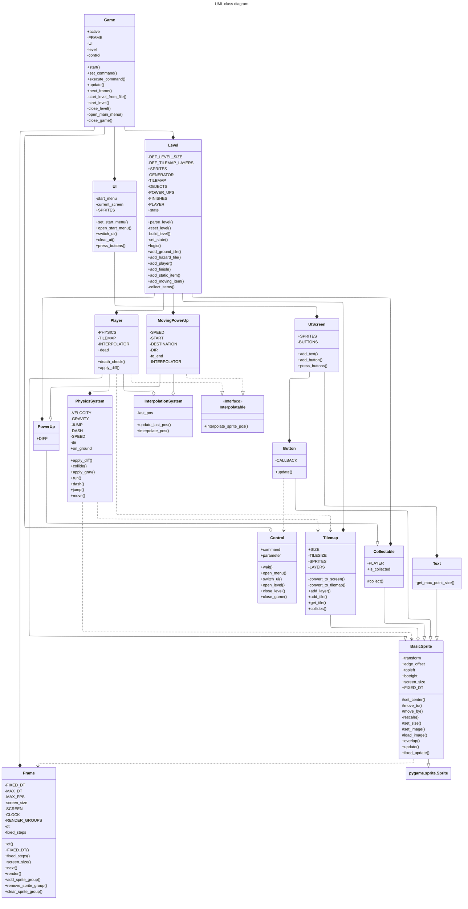
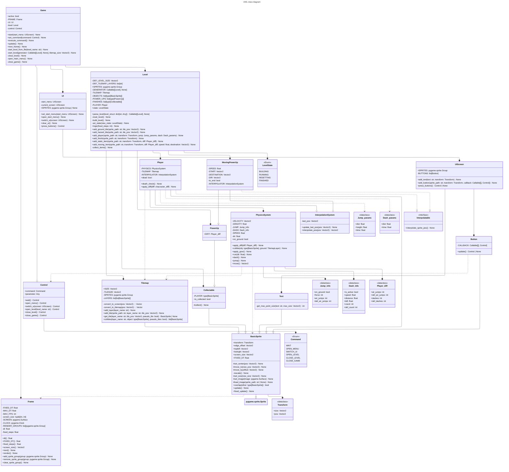

# План рефакторинга (модуль 1-5)

## Модуль 1
- [x] Настроить ENV и добавить Requirements
- [x] Сокрыть ненужные для внешнего пользования функции и свойства
- [ ] Добавить README.md

## Модуль 2
- [x] Попытаться выделить dataclass'ы

## Модуль 3
1) Single responsibility:
	- [x] UI знает о Frame и зависит от него - UI должен хранить, что надо рендерить, а GameManager передаёт это в Frame
	- [x] Level отслеживает фиксированные шаги сам вместо Frame - перенести фикс. шаги в Frame
	- [x] TilemapLayer и TilemapInfo хранятся отдельно, хотя отвечают оба отвечают за один концепт - объединить в один объект Tilemap
2) Dependancy inversion
	- [x] Объекты обращаются к уровню через GameManager - Нужные для взаимодействия объекты передаются в конструктор
	- [x] Character получает доступ к TilemapLayer через GameManager - См. предыдущий пункт
	- [x] Ещё сильнее ограничить доступ к объектам верхнего уровня (например, объект не отдаёт комманду игре, а владелец объекта отслеживает, когда надо отправить команду 

## Модуль 4
- [x] Добавить ограничение на delta_time
- [x] Выделить компоненты (например, местоположение)
- [x] Выделить системы
- [x] Добавить интерполяцию движения

## Модуль 5
- [x] Сделать FSM для Level

# Диаграмма классов
## Упрощённая

## Полная

